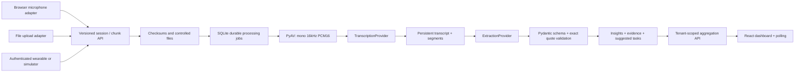

# Architecture

One deployable Python service serves the built SPA, REST API, and one durable job worker. Vite is optional during development. No microservices, paid services or production domain are required.

## Boundaries

- `frontend/src/audio.ts`: browser and file `AudioSourceAdapter` implementations. The adapter produces encoded audio bytes plus source metadata, never a fabricated transcript.
- `backend/app/main.py`: authentication, organization scope, device authorization, versioned transport, typed hardware schemas and application routes.
- `backend/app/audio.py`: bounded audio decoding and normalization, independent of source/transport.
- `backend/app/providers.py`: `TranscriptionProvider` and `ExtractionProvider` protocols plus real faster-whisper and Ollama/compatible-API implementations. `create_app(..., transcriber=..., extractor=...)` is the dependency-injection boundary. There are no production mock-provider options.
- `backend/app/pipeline.py`: database-backed job orchestration, durable stages, retries, evidence persistence and retention. A transcript is committed before extraction so AI failures can retry without retaining audio or re-running speech recognition.
- `backend/app/models.py`: persistence entities. Foreign-key cascades and explicit tenant filters govern access and deletion. Segment arrays are JSON in a transcript row; evidence rows refer to an insight and verified transcript excerpts with server-derived segment bounds.
- `backend/migrations`: versioned Alembic migrations. No runtime `create_all` outside isolated tests/verification.
- `shared/api-contracts`: exported OpenAPI 3.1 and extraction schema, generated from the actual backend.

## Runtime and recovery

Uploads and session metadata commit before enqueueing. One thread drains jobs in a single backend process. `queued` work survives restarts; startup resets interrupted `processing` jobs to `queued`. AI data, insights, evidence and tasks commit atomically. Retry is manual and capped at five attempts. Stages are normalize, transcribe, extract and complete. A failed stage never creates a successful transcript or dashboard metric.

The frontend polls overview/history every five seconds, details every 2.5 seconds and engine setup every 15 seconds, while visible. Errors are surfaced and subsequent polls recover. Filters use server-side search, UTC date bounds and pagination. The dashboard's counts are database-derived; trends show 14 UTC days. Inference and confidence estimates are visible alongside evidence.

## Storage

SQLite database under `local-data/`, with WAL, foreign keys and busy timeout. Encoded audio and normalized WAV stay in a private conversation directory outside the database. Original retention defaults off; both files are deleted after a successful transcript commit. Failed transcription keeps retry input until deletion or retention expiry. No conversation content goes into audit events. Audit rows record actor, action, target and server time.

SQLAlchemy and Alembic support a future PostgreSQL URL (install psycopg separately). PostgreSQL deployment is NOT VERIFIED. Multi-process workers, shared distributed locks, object storage, horizontal scaling and advanced identity are future work; do not run multiple workers against this MVP's single-process queue.

## Model choice

This Mac is Apple Silicon, macOS 26.5.2, with Python 3.12 and Node 22.23.3. Native ARM wheels for CTranslate2 and PyAV installed and ran. faster-whisper avoids a system FFmpeg binary; PyAV contains the decoder. CPU int8 is the tested mode. whisper.cpp is a reasonable future native Metal adapter but adds a separate CMake build/CLI lifecycle and is not implemented. The small English model favors installation speed; domain accuracy and noisy rooms need evaluation.

References used during implementation: [faster-whisper official repository](https://github.com/SYSTRAN/faster-whisper), [whisper.cpp official repository](https://github.com/ggml-org/whisper.cpp), [FastAPI lifespan](https://fastapi.tiangolo.com/advanced/events/), [Ollama structured outputs](https://docs.ollama.com/capabilities/structured-outputs).
